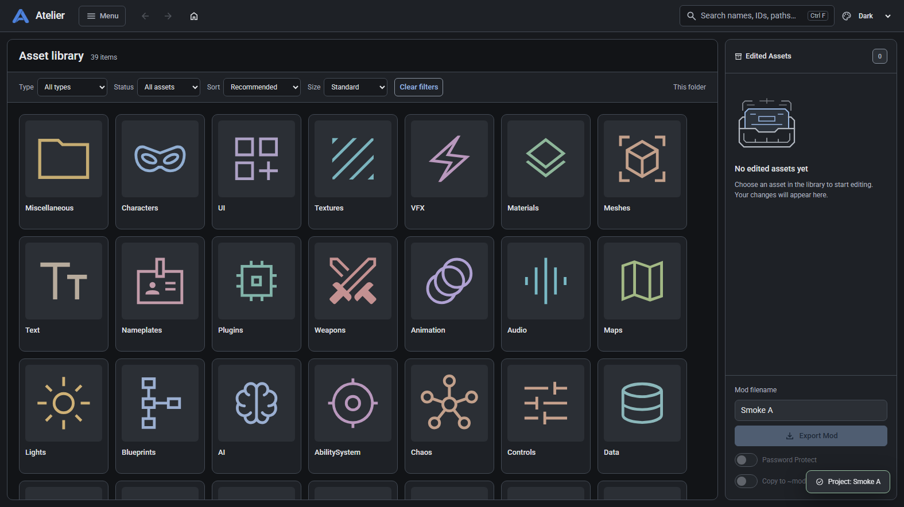
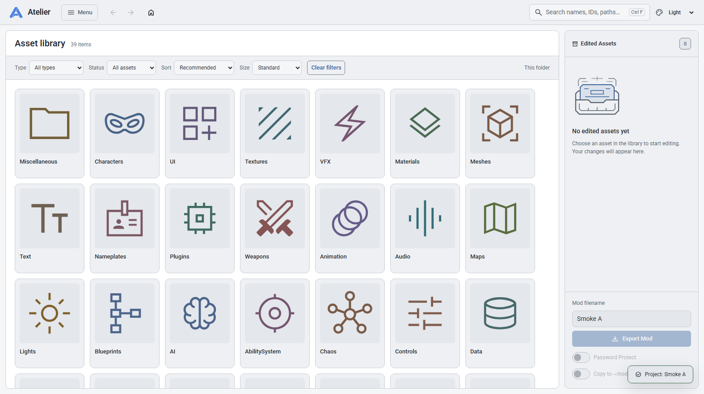
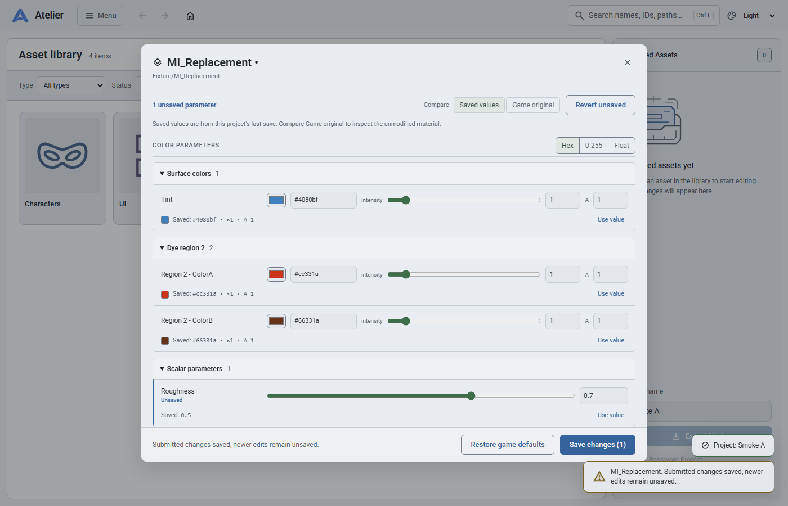

# Atelier studio modernization: maintainer handoff

For 0.4, start with [CHANGELOG.md](CHANGELOG.md) and
[the release notes](docs/release-0.4.0.md). They cover Model Studio, mesh replacement
and morph preservation, texture recovery, stable import thumbnails, and final
Windows/Linux packaging checks. The sections below retain earlier history.

This contribution improves asset browsing, material editing and export review,
with shared light/dark styling and reliability safeguards underneath. It keeps
Atelier's existing Bottle, vanilla JavaScript, Three.js and pywebview stack.
There is no frontend framework migration or project-format migration.

The latest follow-up adds Activity with cancellation/restart status, graceful
managed-job shutdown and reviewed bulk VFX/curve/MPC editing. Native export/readback
checks now cover a painted dyeable material plus a curve, MPC and Niagara effect.
They also identified and fixed serialization of edited zero-valued parameters.
The final section of `DEVELOPMENT.md` records the new checks and their limits;
the portable review package described below predates this follow-up.

The contribution starts at upstream commit `2a3f4e2`. Earlier commits separate
the reliability baseline (`dfe5f5e`), optional portrait catalogue (`6368d68`) and
initial Material 3 foundation (`9bd5ecf`). The subsequent workflow changes build
on those foundations; review the combined branch when evaluating compatibility.

## Visible changes

- Neutral studio surfaces, coordinated light/dark/system themes, local Roboto,
  sharp category symbols and a new Atelier mark. Large previews remain inside
  framed tiles. Category colors remain consistent across folders and shortcuts.
- Current-folder search matches names, hero/skin labels, IDs and paths. Type and
  edited-status filters, natural sorting and four tile sizes make larger folders
  easier to scan. This is not a recursive whole-game search.
- Pin any folder to the library home. Nested pins include their hero/skin context.
  Arrow keys, Home/End, parent/history shortcuts and read-only image/3D previews
  supplement normal click-to-edit behavior.
- Optional cached character/skin artwork, with a background launch update check,
  source/status controls and local icon fallbacks. Catalogue metadata and images
  are independent of mod projects and exports.
- Grouped material parameters, explicit unsaved counts, saved-value references,
  per-value restore controls and comparison with pristine game values. A save
  finishing after another edit preserves the newer draft. Viewport recolors also
  expose saved references and unsaved status.
- Export review lists included/excluded changes and destination settings before
  the existing build request. Results distinguish build failure, skipped items
  and successful builds that could not be installed. Retry is explicit; material
  drafts and in-flight saves block export until resolved.
- Six restrained motion sets: export feedback, viewport loading, folder opening,
  material-save feedback, one-time logo entrance and an empty Edited Assets tray.
  Reduced motion, static fallbacks and cleanup are part of the implementation.

These screenshots use synthetic browser-test fixtures, not extracted game art or
user projects. They demonstrate the interface rather than native mod fidelity.

| Dark theme | Light theme |
| --- | --- |
|  |  |



## Review map

| Area | Entry points | Important behavior to preserve |
| --- | --- | --- |
| Reliability and project ownership | [RELIABILITY.md](RELIABILITY.md), `atelier/operations.py`, `atelier/storage.py`, handlers and routes | Requests remain attached to their originating project; conflicts fail clearly; failed publication preserves previous outputs. |
| Visual foundation | [DESIGN_SYSTEM.md](DESIGN_SYSTEM.md), `gui/tokens.css`, `gui/theme.js`, `gui/icons.js`, `gui/folder-icons.js` | Semantic theme pairs, local assets, keyboard focus and stable icon compatibility. |
| Browsing and artwork | `gui/library-tools.js`, `gui/library-pins.js`, `gui/thumbnails.js`, `atelier/catalogue.py`, `atelier/web/browse.py` | View state does not alter project selection; previews do not import; failed thumbnails settle into retry/fallback states. |
| Material editing | Material editor section of `gui/app.js`, `gui/viewport.js`, `atelier/handlers/material.py` | Saved/current/original values remain distinct; late requests cannot overwrite replacement editors or newer edits. |
| Export review | `gui/export-review.js`, export section of `gui/app.js` | Recheck project, selection and settings before confirm/overwrite/retry; keep saved output separate from installation outcome. |
| Motion | [gui/motion/README.md](gui/motion/README.md) and scoped controllers/adapters | Presentation never starts a backend operation, invents a result or delays input. Missing animation support leaves a usable static interface. |
| Regression coverage | `tests/run_checks.py`, `tests/browser_smoke.py`, `tests/desktop_smoke.py`, `tests/native_smoke.py` | Distinguish isolated fixtures from native tool/game checks; keep test data separate from installed projects. |

`gui/app.js` remains the application coordinator. New presentation modules are
classic scripts with narrow public helpers; they do not introduce a package
manager, bundler or replacement state framework. Further decomposition of the
large editor/viewport modules can proceed independently of the visual changes.

### Compatibility and the new API

Existing Python save/export payloads, Unreal paths, sidecars and mod container
formats are preserved. Native encoding/packing tools are still responsible for
the same formats. The reliability layer adds optional project identity via
`X-Atelier-Project` or image URL `_project`; legacy callers without that identity
retain active-project behavior. Explicitly missing projects and conflicting
destructive operations now fail instead of silently switching targets.

The new read-only route is:

```text
GET /api/material_original?game_rel=<relative game asset path>
```

It returns original `colors`, `scalars` and `textures` alongside `ok` and
`game_rel`, using the existing project/path validation. Unlike the normal project
material reader, it bypasses edited project JSON, decodes/caches pristine data
when needed and never resets or writes a project material. Restart Python after
updating the source so this route is registered. Decoding can populate the
application cache; “read-only” refers to project/game material state.

New successful-build artifact metadata and built-but-not-installed results are
additive. [RELIABILITY.md](RELIABILITY.md) documents those response details and
the deliberately disabled unsafe world round-trip fallback.

## Run from source on Windows

Use 64-bit Python 3.12, Node.js for JavaScript checks, and Microsoft Edge WebView2
for the desktop shell. From the checkout, in PowerShell:

```powershell
py -3.12 -m venv .venv
.\.venv\Scripts\python.exe -m pip install -r requirements-dev.txt
.\.venv\Scripts\python.exe -m playwright install chromium

# Choose a separate local NTFS directory, preferably on the game's drive.
$atelierReviewData = Join-Path $env:LOCALAPPDATA 'AtelierReview'
.\Install-AtelierTools.ps1 -DataDir $atelierReviewData
.\Start-AtelierDev.ps1 -Mode Browser -Port 8770 -DataDir $atelierReviewData
```

Open `http://127.0.0.1:8770`. Configure the game's Paks directory and current
mapping through Setup/Settings. Set the mod destination to a new **test-mods**
folder inside the review data directory. Use one running instance per data
directory. Ctrl+C stops the browser-mode server; CSS/JS changes only require a
reload, while Python changes require a restart.

The tool installer bootstraps the pinned upstream bundle, verifies download
hashes and preserves existing local files. Its custom shader retoc is required;
an ordinary generic retoc binary is not interchangeable. Advanced native checks
also need compatible AtelierMesh, Blender and shader compiler tools as described
in [DEVELOPMENT.md](DEVELOPMENT.md). Tools, keys, mappings, configuration and
extracted game assets are external dependencies, not contribution contents.

After stopping browser mode, launch the desktop shell against the same isolated
data directory:

```powershell
.\Start-AtelierDev.ps1 -Mode Desktop -Port 8778 -DataDir $atelierReviewData
```

Desktop mode defaults to port 8767; `-Port 8778` gives this review instance its
own port. For direct source or packaged launches, the equivalent override is
`$env:ATELIER_PORT = '8778'`. Use separate data directories as well as separate
ports for concurrent instances. Without `ATELIER_DATA_DIR`, installed paths
retain their existing behavior; keep that variable set when trying a review build.

## Reproduce the checks

The automated backend and Chromium suites create disposable application data;
they do not need the user's game projects. The browser tests replace native and
remote services with controlled fixtures and exercise the real frontend.

```powershell
.\.venv\Scripts\python.exe tests/run_checks.py --report-dir _logs/review/backend
.\.venv\Scripts\python.exe tests/browser_smoke.py --report-dir _logs/review/browser
node tests/dom_smoke.js
.\.venv\Scripts\python.exe -m pip check
git diff --check

# Requires the separately configured review tools/game index and WebView2.
$env:ATELIER_DATA_DIR = $atelierReviewData
.\.venv\Scripts\python.exe tests/desktop_smoke.py
```

The final source checks pass **202 Python tests**, with **two native-dependent
cases explicitly skipped**, and **76 Chromium check groups** with no uncaught
page errors. Chromium also renders a real decoded GLB and checks repeated resource
cleanup. Native WebView2 verifies both themes and all six motion sets. The actual
frozen executable also passes its four UI/backend smoke groups using isolated
data and fixture browsing. Final archive provenance and post-package verification
are recorded with the review package and PR.

For a real native pipeline check, run `tests/native_smoke.py` only after choosing
the isolated test-mods destination above. It imports a small real texture into a
disposable project, builds/copies containers to the test destination and checks
unpacked format, dimensions and artifact hashes. An earlier reliability pass
completed that round trip and a real mesh decode; the latest browser fixtures do
not repeat or expand that native compatibility claim.

### Suggested manual review

1. Switch light/dark/system appearance, resize to 1024px and a wide desktop, and
   enable OS reduced motion. Verify that asset colors remain unchanged.
2. Browse and pin a nested skin folder, search by ID/path, combine filters, resize
   tiles and use keyboard previews. Confirm previews do not add edited assets.
3. Edit a material, compare Saved values and Game original, restore one draft
   value, save, and close/reopen. Check that the viewport and export guards retain
   unsaved edits. Inspect the original-data route separately if changing caching.
4. Review an export into the test destination, vary included assets and settings,
   and inspect full success/partial-install/error results using browser fixtures
   or controlled failures. Confirm no automatic export retry occurs.

## Build a review package

```powershell
# Run after committing, from a clean checkout. Output stays outside the repository.
.\.venv\Scripts\python.exe scripts/package_release.py `
  --output-dir 'D:\AtelierBuilds\review'
```

See [PACKAGING.md](PACKAGING.md) for archive checksums, the matching source archive,
runtime licenses and actual frozen-executable verification. Keep the executable
beside its complete `_internal` directory. The spec collects `gui/` recursively,
including local fonts, symbols,
motion files and catalogue seed metadata. Downloaded portraits remain runtime
cache files. The review package does not include native tools, AES keys, mappings,
game assets, private configuration or projects, and does not install dependencies
for the recipient. A built executable is distinct from an installer/release test.

## Remaining release validation

Windows source/Chromium/WebView2 coverage is not an in-game release certification.
Validate representative texture/material/dye, VFX/curve/text, world, Blender,
protected-mod and repatch workflows against a supported game version before a
release. Linux/macOS desktop behavior and installer upgrades need their own runs.

Operation/publication locks coordinate one Python process. Three-file container
replacement is recoverable rather than a single filesystem-atomic transaction;
interruption recovery runs on the next publication to that destination. External
Photoshop/Blender writes are outside those guards. Full legacy-dialog focus
containment, screen-reader auditing and smaller-window accessibility remain
follow-up work. See [RELIABILITY.md](RELIABILITY.md) and
[DESIGN_SYSTEM.md](DESIGN_SYSTEM.md) for the detailed boundaries.

Material Symbols retain their Apache 2.0 license/provenance and Roboto its SIL
Open Font License under `gui/vendor/`. The new mark and adapted animation assets
are documented in the design system and motion inventory. Optional portrait
providers remain external; no fetched portrait collection is bundled here.
