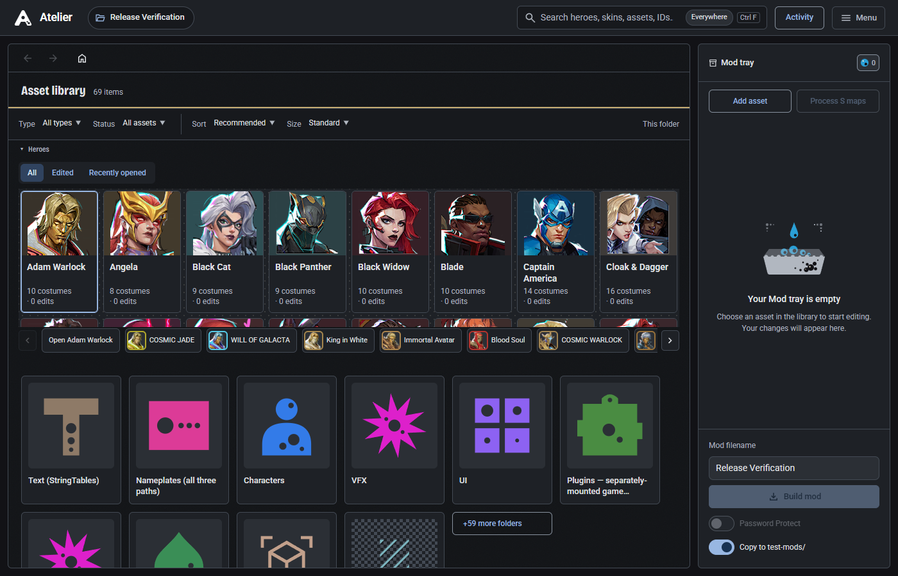
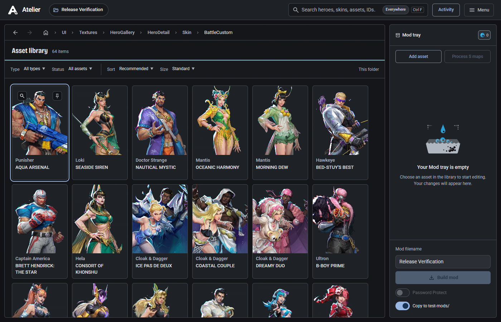
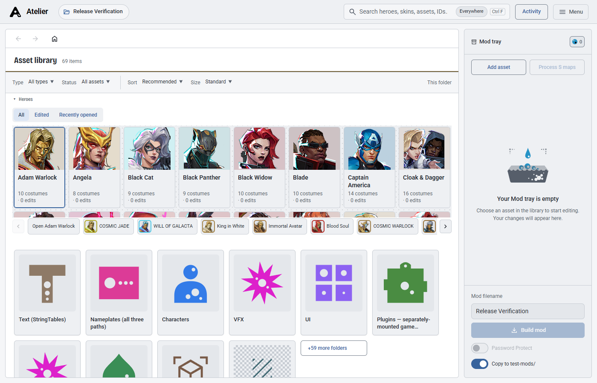
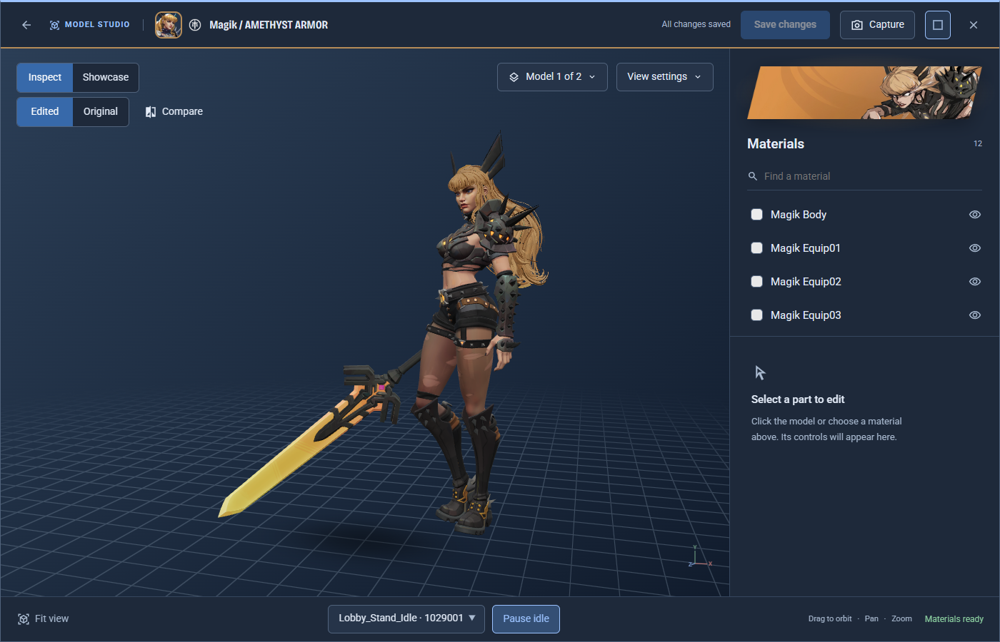
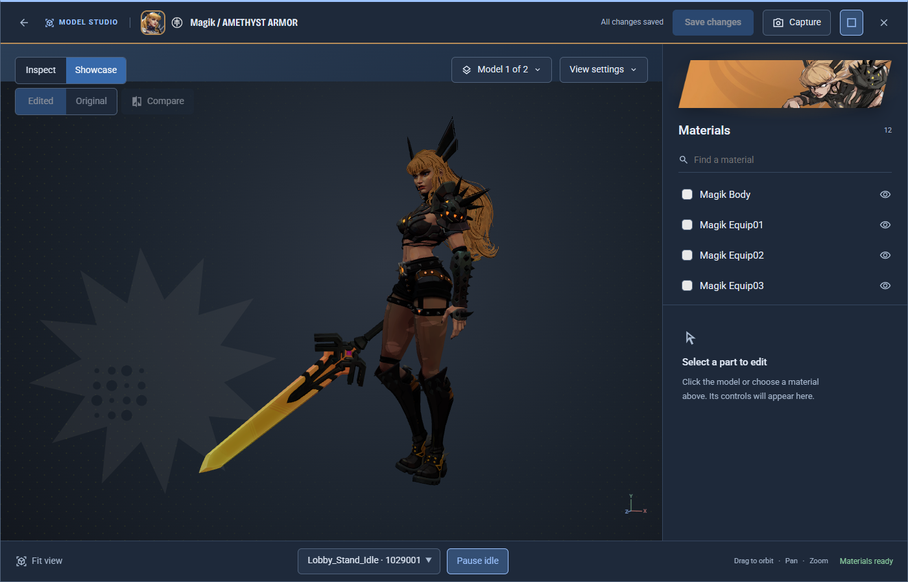
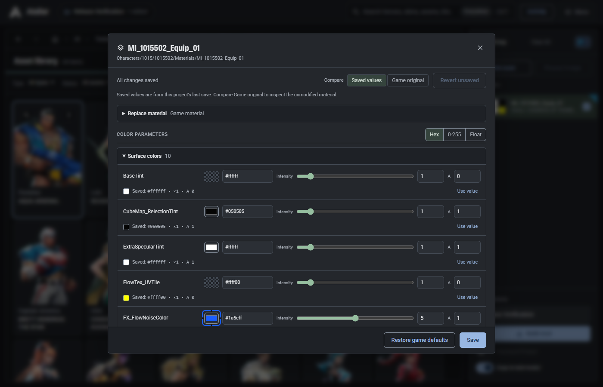
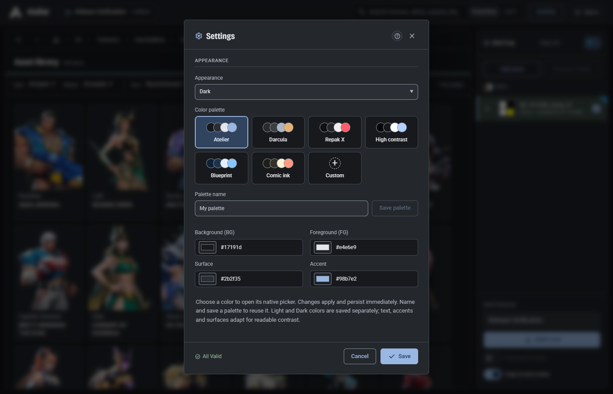
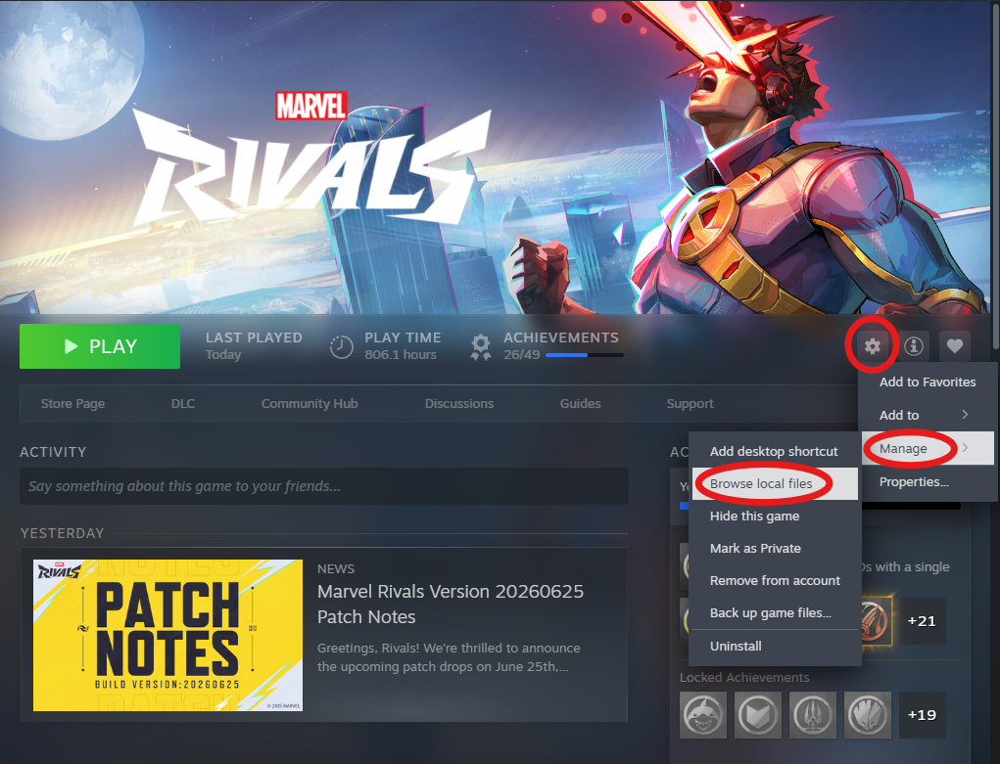

# Atelier: Modding Studio

**Atelier 1.1.1** brings the Marvel Rivals modding workflow together: find heroes
and assets, edit materials and textures, inspect models, and review your mod
before building it. Available for Windows and Linux.

[Download the latest release](https://github.com/clownfetus/Atelier/releases/latest)
· [What's new in 1.1.1](docs/release-1.1.1.md)
· [Development guide](DEVELOPMENT.md)
· [Report an issue](https://github.com/clownfetus/Atelier/issues)

## What's new in 1.1.1

- **Find more folders by name.** Character and costume names and artwork follow
  recognized IDs across the library, search, breadcrumbs, pins and asset pickers.
- **Use HDR cubemaps.** Import Radiance panoramas, six-face strips or HDR DDS
  cubemaps, including material reflection slots, with all six faces retained.
- **Keep Blender projects smaller.** Pack model textures into the `.blend`
  without adding them to the project; existing painted textures are preserved.
- **Prepare models faster on Windows.** Reuse the game reader, batch extraction
  and load the selected body and weapons before optional forms and attachments.
- **Preview and export more reliably.** Character materials, masks, weapon grips,
  alternate forms and the T_Visor texture export error have dedicated fixes.

See the [patch notes](docs/release-1.1.1.md) for details and verification limits.

## Included from 1.1

- **Create assets at your own paths.** Add named textures, material instances and
  meshes, then edit, build, delete or recover them through the normal project workflow.
- **Take Model Studio into Blender.** Export a portable scene with the visible
  body, held weapons, connected materials, packed textures and deformation bones.
- **Replace and refine models.** Choose a body or weapon destination, import
  model/texture bundles, and save individual section visibility into your mod.
- **Browse a clearer library.** Hero and costume nameplates, sharper banners,
  distinct category emblems, saved card sizes and a remembered Heroes startup view.
- **See what changed.** Read the bundled changelog after an update or reopen it
  from the menu, including releases you skipped.

## Included from 1.0

- **Find your next edit faster.** Home opens with hero portraits and costume
  lists. Search Everywhere across heroes, skins, folders and assets, or narrow
  the search to This folder. Continue editing reopens your latest project edit.
- **Swap a whole material.** Search installed materials by character, skin, name
  or path, use one on another asset, and restore the target's game defaults.
- **Present your work.** Model Studio's Inspect and Showcase views offer
  editable previews and cel-lit presentation. Create posters and turntables;
  completed builds can produce a shareable Mod card.
- **Recover deleted edits.** Project trash keeps deleted edits and export
  options together. Undo is available immediately, with seven days of recovery.
- **Make Atelier yours.** The latest Krackle A logo, comic-inspired surfaces,
  readable result captions, new palettes and a Full / Calm / Off motion dial.
  Optional formation sounds start off; system reduced-motion settings take
  precedence.
- **Start and build with clearer guidance.** Three-step setup, progress tied to
  actual work, a Mod tray for edits, and a review before Build mod. A slow update
  service no longer holds up launch.

The app and download files use **1.1.1**. See the [release notes](docs/release-1.1.1.md)
for verification and platform limits. Screenshots show the actual interface with
an isolated, configured game installation; [capture details](images/README.md).

## Features

- **Find assets:** character and skin names, current-folder search by name, ID or
  path, Everywhere search, type/status filters, sorting, adjustable tile sizes and pinned folders.
- **Edit materials:** grouped color, dye-region and scalar parameters, explicit
  unsaved changes, comparison with saved values or the original game material,
  and individual value restoration.
- **Work with textures and meshes:** import replacement textures, add meshes to
  the edit list, replace them with BLEND/FBX/GLB/PSK or cooked Unreal models,
  and open supported mesh workflows in Blender.
- **Inspect models:** switch Original/Edited textures or drag a before/after wipe,
  click a material on the model, inspect labelled dye regions, choose lighting,
  isolate objects, loop a compatible standing idle automatically, and capture a
  poster or turntable. Select a part or material to reveal its editing controls.
- **Review exports:** choose which edited assets to include, check the destination
  before building, and optionally copy the mod into your configured mods folder.
- **Track work:** Activity records imports, exports and repatches. Bulk VFX / curves
  previews supported parameter changes before saving them to the project.
- **Process S maps:** pair edited D textures with S maps in the same folder,
  resize with Bicubic, and apply Color blending at 100% inside Atelier.
- **Choose your appearance:** Light, Dark or System mode, Atelier/Darcula/Repak X
  palettes, and saved custom palettes with separate light and dark colors.
- **Build Skin Swapper mods:** export an edited character mesh in Project Galacta's
  Skin Swapper format, for its Companion App to load. See [Skin Swapper mods](#skin-swapper-mods).

View the light theme

## Model Studio and Showcase

Inspect a model with material picking, lighting controls, original/edited
comparison, and a before/after wipe. Switch to **Showcase** for cel lighting and
a skin-colour dot backdrop. Returning to **Inspect** restores the editable
materials; presentation does not save material changes.

**Export to Blender** saves the selected body and visible held weapons together
in a portable `.blend`, with connected materials, packed images and deformation
bones. Blender must be configured in Settings. Game physics and animation controls
are not recreated. The per-mesh **Edit in Blender** action remains available for
replacement round trips.

For **Edit in Blender**, turn off **Menu → Settings → Behavior → Add model
textures to the project when opening in Blender** to keep the project small.
Textures are packed into the `.blend` instead of becoming project texture edits.
Existing painted project textures are used and left unchanged. The setting is
remembered and starts on to retain the existing painting workflow.

The section eye controls save which parts are hidden in the exported mesh.
Use **Replace model** to choose the body or a separate weapon, then import a
supported model, a model ZIP, or companion files together. Existing game rigs and
physics assets are retained; a different shape may need weight adjustments.

A completed build's **Mod card** records its actual asset counts and version/date.
Copy the image or save a PNG. Cards use a matching loaded Showcase capture, or
clearly labelled catalogue artwork when a capture is unavailable.

## Material editing

### Add an asset at a custom path

Click **Add asset** beside **Process S maps** in the Mod tray. Choose Texture,
Mesh or Material, give it a name, and browse to a destination folder or type a
new one. The dialog shows the final `/Game/Marvel/…` asset path before saving.

Upload an image with a game texture as its format template, upload a cooked
`.uasset` with its matching companion files, or choose **Copy a game asset**.
For FBX, GLB or Blender meshes, copy a compatible game mesh first, then use
**Replace model**. Material uploads must be material instances (`MI_`).

Added assets appear in the library and Mod tray and use the normal editors and
Build mod action. Existing assets at the destination are protected. Original
source packages travel with the project and are included in Delete/Undo.
Use the new package path when referencing the asset from a material or mesh.

### HDR cubemaps

Choose a game **TextureCube** as the template in **Add asset**, or import an
existing HDR cubemap and use **Replace texture**. Supply a Radiance `.hdr` as a
2:1 panorama or a horizontal/vertical strip of six square faces. Six-face HDR
`.dds` files are also supported, including their authored mips. Face strips use
the order **+X, −X, +Y, −Y, +Z, −Z**.

The template keeps its TextureCube type and FloatRGBA or BC6H format. Atelier
stores the HDR payload as DDS and displays a separate tone-mapped PNG preview.
In a material's Texture slots, **Use my HDR cubemap…** assigns one directly to
a reflection slot. Build the mod normally; Unreal Editor is not required.

Faces are limited to 2048 pixels; image inputs to 32 megapixels and 512 MB.
This currently supports complete inline UE5 cubemaps. HDR Texture2D, EXR,
virtual textures and cube arrays are unsupported. Native packing and independent
readback are verified; in-game rendering still needs confirmation. See the
[verification details](docs/identity-hdr-blender-verification-2026-10-22.md).

### Process S maps

Click **Process S maps** under **Mod tray** to process every imported texture
whose name ends in `_D`. The export checkboxes and library filters do not limit
this action. Matching uses the same game folder and the corresponding `_S` name;
numbered D maps can share an unnumbered S map, with a pairing chooser whenever
several D maps could drive the same S map. Unmatched textures are skipped.

Atelier uses a saved project S map when present, otherwise imports it from the
game. Each D is resized to the S map's dimensions using Bicubic, then applied
with built-in Color blending at 100% opacity. D files remain unchanged; S alpha
is retained and transparent D pixels mask the color change. Photoshop is not
required. The blend follows the [standard non-separable Color formula](https://www.w3.org/TR/compositing-1/#blendingcolor),
rather than relying on a native Photoshop document or its color-profile settings.

Processed S maps appear in Mod tray for normal export. Activity lists the
pairings and skipped paths. Original S inputs and a batch record are retained
inside the project's `.atelier/s-map-backups/` directory. Cancellation and failures
before publication leave project images untouched; a failed publication rolls
back the batch.

### Material parameters

Inspect surface colors, dye regions and scalar groups together. Compare against
the project's saved values or **Game original**, restore individual values, and
save when ready. New edits made during a save remain marked as unsaved.

### Replace a material

Open the target material and expand **Replace material**. Search by character,
skin, asset name or path, select a result (or paste its `/Game/Marvel/…` path),
then click **Use this material**. Character and skin names use the installed
reference table. The replacement saves immediately; export the target material
through the Mod tray as usual.

The donor's parent, textures, static switches and cooked shader data are kept,
while the target keeps its package path and name. Donor project edits are not
copied. You can edit the replacement's exposed parameters and texture slots.
**Restore game defaults** restores the target's original material and removes
custom texture assignments. Failed reads or publication preserve saved edits.

This supports installed `MI_` material instances in the main game content, rather
than arbitrary uploaded JSON. A source that inherits from the target is refused
to prevent a circular parent chain. UVs, vertex colors and character-specific
shader inputs can change the appearance on another model; animated shaders are
not fully represented in the preview. Native container readback is verified;
in-game appearance still needs checking.

## Appearance

Open **Menu → Settings → Appearance** to choose a mode and palette. Use **Custom**
to change the background, foreground, surface and accent, then name and save the
palette to reuse it. Appearance is also available during first-run configuration.

## Installation

### Windows

1. Download **AtelierSetup.exe** from the
   [latest official release](https://github.com/clownfetus/Atelier/releases/latest).
2. Run the installer, then launch Atelier.
3. Follow **Find the game → Unlock the paks → Make it yours**. Select your
   Marvel Rivals folder and provide a current USMAP mapping and AES key if
   automatic retrieval is unavailable. The
   [Help section](#help) has links if automatic retrieval is unavailable.
4. In **Menu → Settings**, choose your mods folder to enable **Copy to ~mods/**.

The Windows desktop window uses Microsoft Edge WebView2. **Edit in Blender** and
**Open in Blender** also require a separate Blender installation; set its
executable path in Settings.

### Linux

Download an `.AppImage` from a [release with a Linux build](https://github.com/clownfetus/Atelier/releases),
mark it executable, and launch it. See [LINUX.md](LINUX.md) for platform setup.
Download a new AppImage when updating; the in-app installer update flow is Windows-only.

## Updates

Atelier checks the main repository's latest published release at launch. On
Windows, a newer version offers **Update Now** or **Later**. **Update Now**
downloads `AtelierSetup.exe`, launches the installer and closes Atelier.
Installation requires that choice; updates are not installed silently at launch.

If the update prompt is unavailable, close Atelier and download/run the latest
official `AtelierSetup.exe` manually. Use the existing installation directory;
the installer is designed to retain projects, exports and settings.

Commits and merged pull requests do not update installed copies. Maintainers
must build and publish a higher-version release with the installer attached.
Source checkouts are updated through Git; see [DEVELOPMENT.md](DEVELOPMENT.md).

## Basic workflow

On first run, Find the game and Unlock the paks validate your installation before
Make it yours offers palettes and motion. Key/mapping retrieval has manual
fallbacks. Menu → Settings keeps the full configuration form.

1. Create or open a project. The project button beside the Atelier logo shows
   the open project and its edit count; click it to switch projects.
2. Browse to the assets you want to change. Edit material parameters or
   right-click a texture to replace it with an external image.
3. Select the assets to include under **Mod tray** and enter a mod filename.
   Enable **Copy to ~mods/** to install into your configured mods folder. Optional
   **Password Protect** uses the protection password from Settings.
4. Click **Build mod**, review the included assets and destination, then confirm.

Open **Activity** to review job progress and results or cancel work before file
publication. Interrupted work is recorded after reopening and does not restart
automatically.

Deleting edits moves their files and export options into that project's trash.
Choose **Undo** within 10 seconds to restore the batch; hovering pauses the toast.
Shift-click Delete skips the prompt and keeps Undo available. Trash is kept for
7 days, up to 20 batches, and is excluded from mods and project archives.
Deleting an entire project remains permanent and asks for confirmation.

Home leads with hero portraits, costume/edit counts and All / Edited / Recently
opened filters. Costume buttons open Model Studio, or their folder when no mesh
is available. **Continue editing** reopens the latest project edit in its editor.
The search field defaults to **Everywhere**, grouping heroes, costumes, folders
and assets. Switch to **This folder** for local filtering; arrow keys and Enter
navigate global results, and Escape closes them.

Use **Bulk VFX / curves** to preview a multiplier or RGB replacement across
supported assets in the selection or current folder. RGB edits preserve alpha.
Global material parameter collections are labelled because changes can affect
every referencing material. Save the reviewed batch, then export separately.

## Skin Swapper mods

Atelier can export an edited character mesh as a mod for Project Galacta's
Skin Swapper, which its Companion App then loads.

1. Edit a skin's mesh in Blender or replace it with **Replace model…** using your
   own BLEND, FBX, GLB or PSK file, then select it under **Mod tray**.
2. Set the mod filename. It becomes the Galacta folder name, so use letters,
   digits and underscores only.
3. Click **Build mod** and choose **Skin Swapper mod (Project Galacta)**. The hero
   and skin come from the mesh and cannot be changed. Enter the skin name and
   author, and pick a form for multi-form heroes (Form 0 is the default).
4. Click **Build Skin Swapper mod**, then add the mod in the Companion App.

The mod holds only your mesh and a Galacta config for it, under
`/Game/Marvel/ProjectGalacta/Meshes/{HeroID}/{SkinID}/{ModFolder}/`. Atelier
never ships game assets in these mods: unedited meshes and models imported from
cooked game files are refused. The top-level mesh geometry must differ from the
game's: re-saving in Blender or recooking alone does not qualify. It never creates
or edits `skins.txt`; the Companion App manages that. Project Galacta can switch this export off, and the
review then says why.

To test the integration from source, see [Testing Skin Swapper export](docs/skin-swapper-testing.md).

## Help

To find the game folder in Steam, right-click **Marvel Rivals → Manage → Browse
local files**, then select that installation folder in Atelier.

Steam folder location

If automatic key or mapping retrieval is unavailable, obtain the current files
and update them in **Menu → Settings**:

- [AES key help on Discord](https://discord.com/channels/1419106202511609958/1485413590310584374/1485417747834863616)
- [USMAP mapping files from SpaceHost](https://spacedepot.github.io/SpaceHost/)

### Windows notices

Releases are unsigned, so Windows may show an unrecognized-app warning. Confirm
that the download came from the official repository before deciding to run it.
If antivirus software blocks a file, review the specific detection and include
its details when reporting an issue; a warning alone does not establish whether
a file is safe.

## Development and release builds

See [DEVELOPMENT.md](DEVELOPMENT.md) for isolated source setup and verification,
[CONTRIBUTION_NOTES.md](CONTRIBUTION_NOTES.md) for the feature/review map, and
[PACKAGING.md](PACKAGING.md) for portable review packages. A portable review ZIP
must be extracted in full; `Atelier.exe` needs its adjacent `_internal` directory.

To make a Windows release discoverable by existing installations:

1. Build the intended source with a higher numeric version, such as `0.4.0`.
   [BUILD.bat](BUILD.bat) writes the application version and supplies the matching
   version to the installer compiler. Verify the installer and upgrade behavior
   using the [installer checks](DEVELOPMENT.md#disposable-windows-installer-verification).
2. Publish a stable release in **clownfetus/Atelier**, using that numeric tag
   (`0.4.0` or `v0.4.0`) and attaching the installer named **AtelierSetup.exe**.
3. Make it the latest release. The updater requires a version higher than the
   installed version; replacing an EXE under the same version will not trigger it.

Drafts and prereleases are not the stable update channel. The Windows installer
verification workflow checks candidate installers; it does not build or publish
a release automatically.

## Collaborators

- Tendo ([tendo625](https://github.com/tendo625))

## Credits

- Noobmaster and Clownfetus
- Xzant ([UAssetToolRivals](https://github.com/XzantGaming/UAssetToolRivals))
- Natimerry ([repak-rivals retoc](https://github.com/natimerry/repak-rivals/))
- Saturn ([Repak-X](https://github.com/XzantGaming/Repak-X), [SpaceHost](https://spacedepot.github.io/SpaceHost/))
- donutman07 ([Character IDs](https://github.com/donutman07/MarvelRivalsCharacterIDs/))
- [RivalSkins](https://rivalskins.com/heroes/) for optional hero and skin artwork
