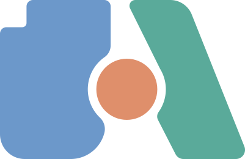
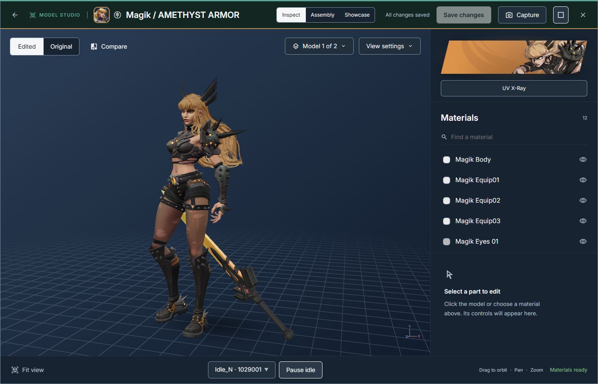

  

<h1 align="center">Atelier</h1>

  <strong>Make your own Marvel Rivals mods.</strong> 
  Recolour a costume, swap a weapon model or change the colour of an effect.
  Atelier lets you preview your edits in 3D and build a mod you can install.

  <strong><a href="https://github.com/clownfetus/Atelier/releases/latest">Download for Windows or Linux</a></strong>
  · <a href="#quick-start">Quick start</a>
  · <a href="docs/USER_GUIDE.md">User guide</a>

## What you can do

- **Find a costume or part by name.** Browse heroes and their costumes, or search
  the game’s assets for the piece you want to change.
- **Give a costume a new look.** Recolour individual parts, adjust how a surface
  catches the light, or import a texture you painted in your image editor.
- **See your edits in 3D.** Rotate the model under different lighting and drag a
  slider between the original and edited textures. Save a poster or a rotating
  preview from Showcase.
- **Reshape a character or weapon.** Send a model and its textures to Blender,
  bring the edited model back into Atelier, or import a replacement model.
- **Edit effects on a timeline.** Set how colours change over time for supported
  effects. Apply the same change to several materials or effects in one go.
- **Build a mod you can install.** Choose which edits to package, review the
  output and copy the finished mod to your game’s mods folder from Atelier.

## Quick start

1. Open the [latest release](https://github.com/clownfetus/Atelier/releases/latest).
   Under **Assets**, choose `AtelierSetup.exe` for Windows or the x86-64
   AppImage for Linux. Run the Windows installer or follow the
   [Linux setup guide](docs/LINUX.md#install-and-update).
2. Launch Atelier, select your Marvel Rivals installation and follow the setup
   wizard.
3. Create a project, find an asset and make an edit.
4. Select the edits to include in the **Mod tray**, then choose **Build mod**.
   Review the contents and destination before confirming.

To find your game folder in Steam, right-click **Marvel Rivals → Manage → Browse
local files**. If Atelier asks for an unlock key or mapping file, follow the
[first-run setup guide](docs/USER_GUIDE.md#first-run-setup).

## Guides and support

- [User guide](docs/USER_GUIDE.md) for step-by-step help with setup, editing
  and building mods.
- [Preview and edit models](docs/USER_GUIDE.md#model-studio-and-showcase)
  · [Blender setup](docs/BLENDER.md#send-to-blender-or-export-a-portable-scene)
- [Add your own assets](docs/USER_GUIDE.md#add-an-asset-at-a-custom-path)
  · [Replace a material](docs/USER_GUIDE.md#replace-a-material)
- [Import HDR cubemaps](docs/USER_GUIDE.md#hdr-cubemaps)
  · [Process S maps](docs/USER_GUIDE.md#process-s-maps)
  · [Export for Skin Swapper](docs/USER_GUIDE.md#skin-swapper-mods)
- [Update Atelier](docs/USER_GUIDE.md#updates)
  · [Latest release notes](https://github.com/clownfetus/Atelier/releases/latest)
  · [Changelog](CHANGELOG.md)
- [Report an issue](https://github.com/clownfetus/Atelier/issues) with your
  Atelier version, operating system and steps to reproduce the problem.

## Development

[Run from source](docs/DEVELOPMENT.md#run-from-source) ·
[0.4 development handoff](docs/CONTRIBUTION_NOTES.md) ·
[Packaging](docs/PACKAGING.md) ·
[Release workflow](docs/automatic-releases.md)

## Credits

Noobmaster, Clownfetus and collaborator [Tendo](https://github.com/tendo625).
Atelier is licensed under the [GNU General Public License v3](LICENSE).

- Xzant · [UAssetToolRivals](https://github.com/X-zant/UAssetToolRivals)
- Natimerry · [repak-rivals retoc](https://github.com/natimerry/repak-rivals/)
- Saturn · [Repak-X](https://github.com/X-zant/Repak-X) and [SpaceHost](https://spacedepot.github.io/SpaceHost/)
- donutman07 · [Character IDs](https://github.com/donutman07/MarvelRivalsCharacterIDs/)
- [RivalSkins](https://rivalskins.com/heroes/) for optional hero and skin artwork
