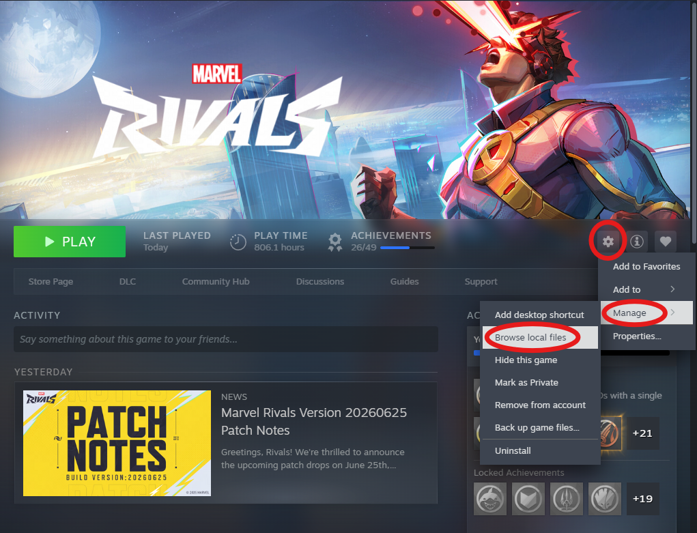
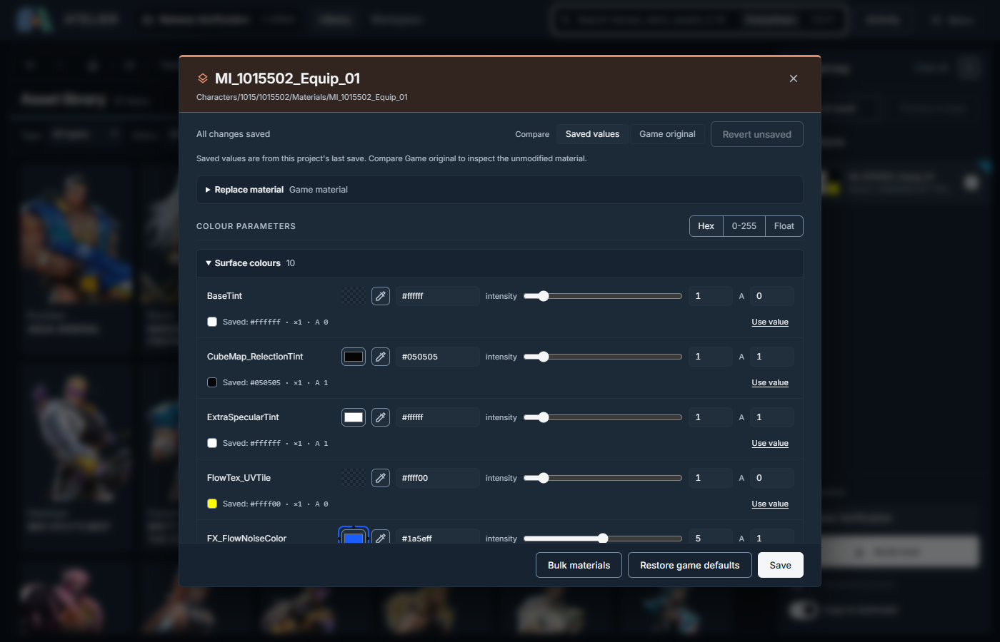

# Atelier user guide

[Project overview](../README.md) · [Download Atelier](https://github.com/clownfetus/Atelier/releases/latest)

- [First-run setup](#first-run-setup) and [updates](#updates)
- [Build your first mod](#build-your-first-mod)
- [Preview and edit models](#model-studio-and-showcase) and [work in Blender](BLENDER.md#send-to-blender-or-export-a-portable-scene)
- [Edit textures and materials](#textures-and-materials)
- [Edit effects and materials in batches](#batch-edits-and-effects)
- [Export for Project Galacta’s Skin Swapper](#skin-swapper-mods)

## First-run setup

Choose your download under **Assets** on the [latest release](https://github.com/clownfetus/Atelier/releases/latest).
On Windows, run `AtelierSetup.exe`. The desktop window uses the Microsoft Edge
WebView2 runtime. The installer is unsigned, so Windows may show an unrecognised-app
notice. On Linux, choose the x86-64 AppImage and follow the [Linux setup guide](LINUX.md#install-and-update).

1. In Atelier, follow **Find the game → Unlock the paks → Make it yours**.
   Select your Marvel Rivals installation. In Steam, right-click the game and
   choose **Manage → Browse local files** to find the installation folder.
2. If Atelier asks for the game’s AES key or USMAP mapping file, supply the
   current ones in the wizard. You can update them later in **Menu → Settings**.
   See [AES key help on Discord](https://discord.com/channels/1419106202511609958/1485413590310584374/1485417747834863616)
   and [USMAP mapping files from SpaceHost](https://spacedepot.github.io/SpaceHost/).
3. Set your mods folder in **Menu → Settings** to enable **Copy to ~mods/**.
   Under **Paths**, you can also choose your preferred image editor and set the
   Blender executable for portable export and per-mesh editing.

See where Steam shows the game folder

In **Menu → Settings → Appearance**, choose Light, Dark or System mode, select
a preset or save your own palette. Motion is available in Full, Calm and Off,
with optional sounds.

## Updates

Atelier checks for the latest published release on launch. Choose **Download
Update**, then **Restart and Update** when you’re ready. **Restart Later** lets
you finish your work first. Compatible Windows updates download only changed
app files. Skipped versions may use the full package, and runtime changes use
the installer. Linux replaces the AppImage on restart. The updater verifies
downloads against signed metadata and restores the previous app version after
a failed startup.

To update manually on Windows, close Atelier and run the [latest installer](https://github.com/clownfetus/Atelier/releases/latest)
in the existing installation directory so you keep projects, exports and settings.
For Linux, use the [AppImage update steps](LINUX.md#install-and-update).

## Build your first mod

1. Create or open a project using the project button beside the Atelier logo.
2. Find a hero or costume in the **Library**. **Everywhere** searches heroes,
   costumes, folders and assets. **This folder** filters the current folder.
   **Continue editing** reopens the project’s latest edit.
3. Open a material to change its settings. To repaint a texture, choose
   **Edit this asset**, then right-click the imported texture and select
   **Replace with Image** or open it in your image editor.
4. Select the edits you want under **Mod tray** and enter a mod filename.
   Enable **Copy to ~mods/** to copy the mod to your configured mods folder.
5. Click **Build mod**, review the included assets and destination, then confirm.

Open **Activity** to see progress, results and warnings, or cancel work before
files are written to their final destination. Interrupted jobs are recorded
when you reopen the app.

Deleted edits and their export options go to the project’s trash. Choose
**Undo** within 10 seconds to restore the batch. Hover over the toast to pause
the timer. Shift-click Delete skips the prompt and still offers Undo. Trash
keeps up to 20 batches for seven days and is excluded from mods and project
archives. Deleting an entire project is permanent and asks for confirmation.

## Model Studio and Showcase

Open a costume to inspect it in 3D. Click a part of the model to find its
material controls, switch between **Original** and **Edited**, or drag the
**Compare** wipe between textures. Change the lighting, isolate parts, or
switch to **Assembly** to see the selected surface’s material and texture slots.

Use **Showcase** for cel lighting and a skin-colour backdrop. **Capture** can
save a poster or turntable. Returning to **Inspect** restores the editable view.

- **Send to Blender (live)** imports the visible body and held weapons into an
  open Blender scene with the bundled Atelier Live Bridge enabled.
- **Export portable .blend** saves a standalone scene with connected materials,
  packed images and deformation bones. Game physics and animation controls
  are outside the scene export.
- **Edit in Blender** opens a project mesh for changes you can bring back into
  the mod. To pack its newly decoded textures into the scene instead of adding
  project edits, turn off **Menu → Settings → Behavior → Add model textures to
  the project when opening in Blender**.

Use the section eye controls to save which parts are hidden in the exported
mesh. **Replace model** lets you choose the body or a separate weapon, then
import a supported BLEND, FBX, GLB, PSK or cooked Unreal model with its companion
files. Atelier keeps the game rig and physics assets. A different shape may need
weight adjustments.

[Set up Blender and the Live Bridge](BLENDER.md#send-to-blender-or-export-a-portable-scene)

## Textures and materials

### Material parameters

Edit grouped surface colours, dye regions and scalar values. Compare against
the project’s saved values or **Game original**, restore individual values and
save when ready.

### Replace a material

Open the target material and expand **Replace material**. Search by character,
costume, asset name or path, then select a result or paste its `/Game/Marvel/…`
path. Click **Use this material**. The replacement saves immediately and can be
included through the Mod tray.

Atelier copies the donor’s installed game material, including its parent,
textures, static switches and cooked shader data. The target keeps its package
path and name. You can then edit the replacement’s exposed parameters and
texture slots. **Restore game defaults** restores the target’s original material
and clears custom texture assignments.

This works with installed `MI_` material instances from the main game content.
Atelier rejects donors that inherit from the target to avoid circular inheritance.
UVs, vertex colours and shader inputs can change how the donor looks on another
model. Preview support for animated shaders is limited. Native container
readback has been verified. Check the appearance in game after export.

### Add an asset at a custom path

Click **Add asset** beside **Process S maps** in the Mod tray. Choose Texture,
Mesh or Material, give it a name and select or type the destination folder.
The dialog shows the final `/Game/Marvel/…` path before saving.

Upload an image with a game texture as its format template, upload a cooked
`.uasset` with its matching companion files, or choose **Copy a game asset**.
For FBX, GLB or Blender meshes, copy a compatible game mesh first, then use
**Replace model**. Material uploads must be material instances (`MI_`).

Added assets appear in the library and Mod tray. Existing assets at the
destination are protected. Original source packages travel with the project and
are included in Delete/Undo. Use the new package path when referencing the
asset from a material or mesh.

### HDR cubemaps

Choose a game **TextureCube** as the template in **Add asset**, or import a
supported game TextureCube and choose **Replace with Image** from its context
menu. Supply a Radiance `.hdr` as a 2:1 panorama or a horizontal or vertical
strip of six square faces. Six-face HDR `.dds` files can also retain their
authored mips. Use face order **+X, −X, +Y, −Y, +Z, −Z** for strips.

The template keeps its TextureCube type and FloatRGBA or BC6H format. Atelier
stores the HDR payload as DDS and shows a tone-mapped PNG preview. Open a
material’s **Texture slots** and choose **Use my HDR cubemap…** to assign it to a
reflection slot, then build the mod normally.

Faces are limited to 2048 pixels, and image inputs to 32 megapixels and 512 MB.
This supports complete inline UE5 cubemaps. HDR Texture2D, EXR, virtual textures
and cube arrays are unsupported. The [verification details](identity-hdr-blender-verification-2026-10-22.md)
cover native packing and readback. In-game rendering still needs confirmation.

### Process S maps

Click **Process S maps** under **Mod tray** to process every imported texture
whose name ends in `_D`. Export checkboxes and library filters do not restrict
this action. Atelier looks for a matching `_S` name in the same game folder.
Numbered D maps can share an unnumbered S map. If several D maps could drive the
same S map, choose a pairing when prompted.

Atelier uses a saved project S map when present or imports it from the game.
Each D is resized to the S map’s dimensions using Bicubic, then applied with
built-in Color blending at 100% opacity. The blend preserves S alpha and leaves
the D map intact. Transparent D pixels mask the colour change. Atelier uses
the [standard non-separable Color formula](https://www.w3.org/TR/compositing-1/#blendingcolor).

Processed S maps appear in the Mod tray. **Activity** lists pairings and
skipped paths. Original S inputs and a batch record are kept in
`.atelier/s-map-backups/`. If publication fails, Atelier rolls back the batch.

## Batch edits and effects

Use **Bulk VFX / curves** to preview a multiplier or RGB replacement across
supported assets in the selection or current folder. RGB edits preserve alpha.
Global material parameter collections are labelled because changes can affect
every material that uses them. Save the reviewed batch, then export it.

**VFX Motionboard** shows the colour tracks for supported Niagara effects on a
timeline with playback and comparison. Use **Bulk edit materials** to change
the same parameters across up to 1,000 materials at once.

## Skin Swapper mods

Atelier can export your edited character mesh for Project Galacta’s Skin
Swapper. Add the resulting mod in the Companion App.

1. Edit a skin’s mesh in Blender or choose **Replace model…** and import your
   own BLEND, FBX, GLB or PSK file. Select it under **Mod tray**.
2. Set the mod filename. It becomes the Galacta folder name and accepts letters,
   digits and underscores.
3. Click **Build mod** and choose **Skin Swapper mod (Project Galacta)**. Enter
   the skin name and author. Atelier takes the hero, skin and form from the mesh.
   Multi-form mesh names supply their ShapeID. Without one, Atelier uses form 0.
4. Click **Build Skin Swapper mod**, then add the mod in the Companion App.

The export contains your mesh and its Galacta config in
`/Game/Marvel/ProjectGalacta/Meshes/{HeroID}/{SkinID}/{ModFolder}/`. It requires
geometry that differs from the game’s mesh. Imports must come from a supported
modelling format such as FBX. Re-saving in Blender or recooking alone is
insufficient. The Companion App manages `skins.txt`. If this format is disabled
by Project Galacta, the build review explains why.

[Skin Swapper integration testing](skin-swapper-testing.md)
