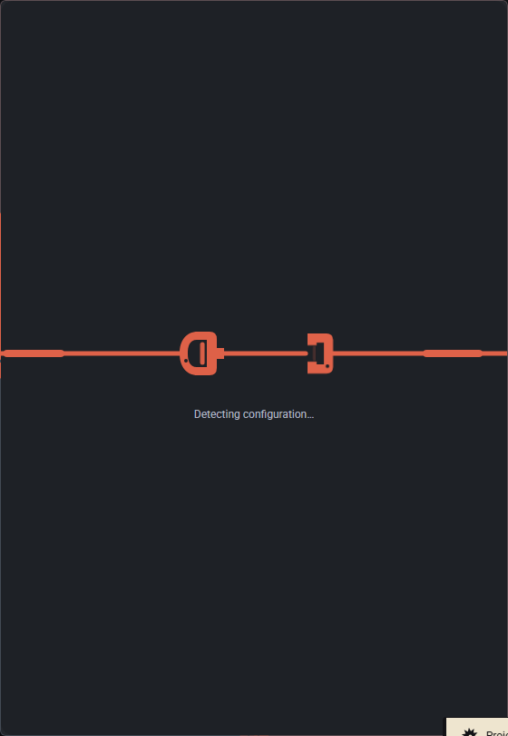
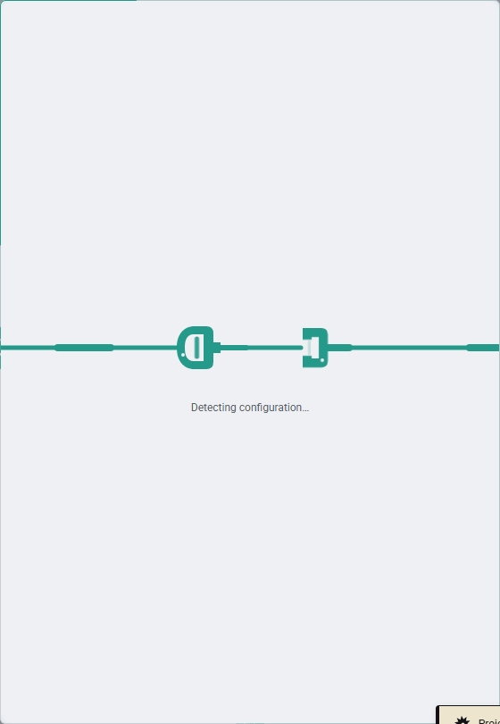
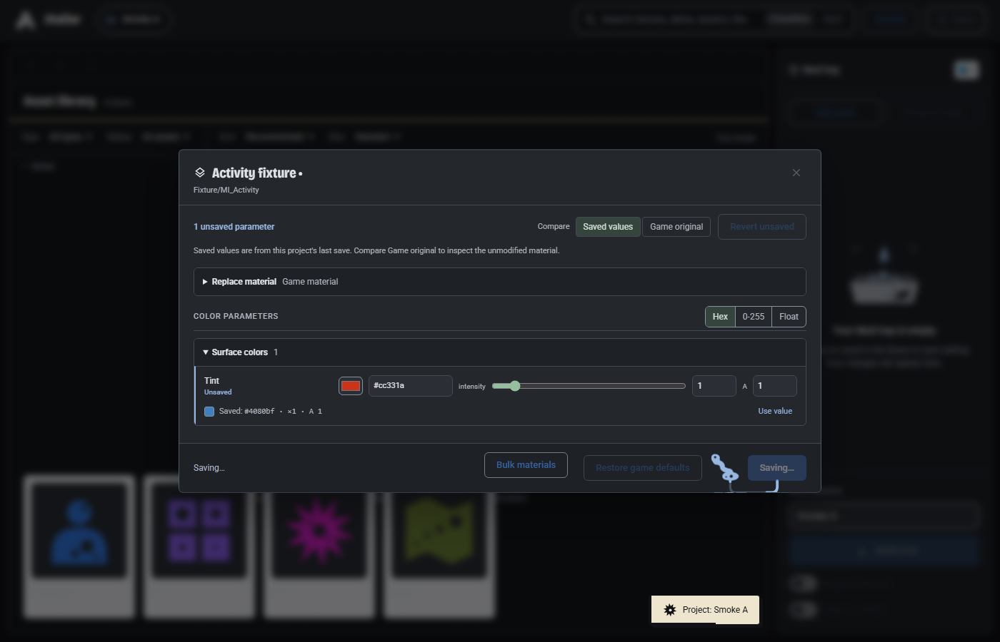
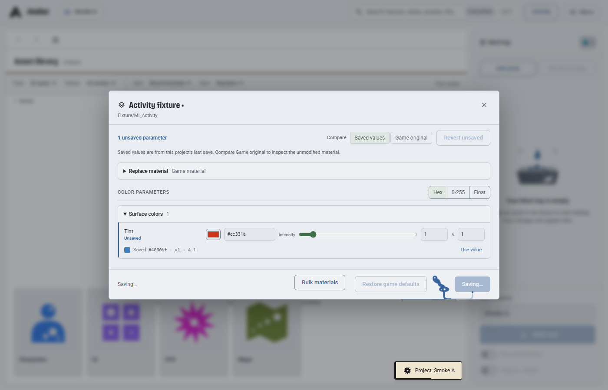
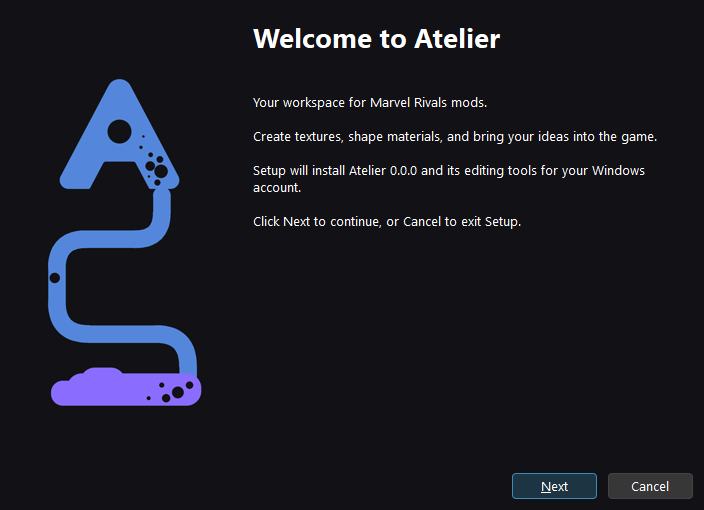
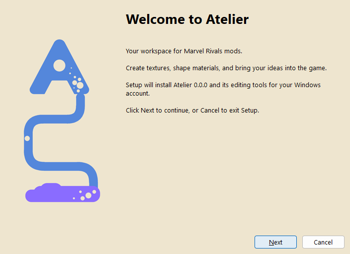

# Connected ink and installer review

Verified on 22 October 2026 against the PR checkout with current `main` integrated.
All captures are unmodified. Browser images use disposable offline fixtures; the
installer images use a non-installing appearance preview with version `0.0.0`.
Release builds receive their real version from the existing build pipeline.

## Motion concepts

| Action | Source and destination | Receiving reaction |
| --- | --- | --- |
| Loading a panel or model | Heading/inlet feeds the panel's native border and loading reservoir | The ready frame catches and spreads the ink as content appears |
| Saving edits | Reservoir feeds a continuous ribbon, footer seam and Save control | Compression, rebound and border spread; closed editors hand the receipt to the Mod tray header |
| Finding configuration | Left panel seam feeds a scanner, a continuous channel and a configuration latch, then the right seam | The panel receives the real discovery result |
| Exporting | Selected Mod tray content feeds the export destination | The completed export presses a finite seal into its button seam |

Ink follows the current hero/skin artwork; semantic status colours stay distinct.
Incomplete persistence or newer drafts produce a partial catch. Failure drains the
flow. Closed panels, stale responses and hidden completions cannot replay success.
Calm, Off and system reduced motion retain usable static feedback. Try Krackle in
Settings can replay the authored gestures and the connected Edit-to-Mod-tray flow.

## Browser captures

## Installer captures

The A mark supplies a continuous ink channel that lands in a receiving seal.
Paper and Ink variants match the app while preserving native Windows controls,
keyboard interaction and the existing install/update/uninstall behavior.

## Validation

| Focused browser run | Passed checks |
| --- | ---: |
| Working borders, configuration, save/export outcomes and model loading | 49 |
| Contextual pigment, workflow gestures and connected transfers | 34 |
| Folder, texture, empty-state, logo and global feedback motion | 35 |
| Library, editor and studio polish | 14 |

All four runs completed with no uncaught page errors. The real browser checks
hold API responses to exercise errors, retries, newer drafts and same-file reopen
races. Raster checks verify connected opaque ink at native glyph sizes, native
border alignment and unchanged panel interior pixels. The focused offline harness
ran the production check functions while omitting unrelated update/changelog
startup checks. It did not run the entire release suite.

Also passed: 18 frontend-cache and packaging tests, syntax checks for all 27
changed/new JavaScript files, `git diff --check`, and the Krackle/installer artwork
generator consistency checks.

The production installer definition compiled with pinned Inno Setup 6.7.3 against
isolated stub payloads. Separate native appearance previews were inspected through
Welcome, License, Location, Shortcuts and Ready in both themes, including resized
Ready pages. Both previews cancelled without creating their destinations; their
Install actions were disabled and independently blocked. This verifies appearance
and compilation, not a release installation. Higher DPI, high contrast and actual
install/progress/finish execution were not exercised in this pass.
